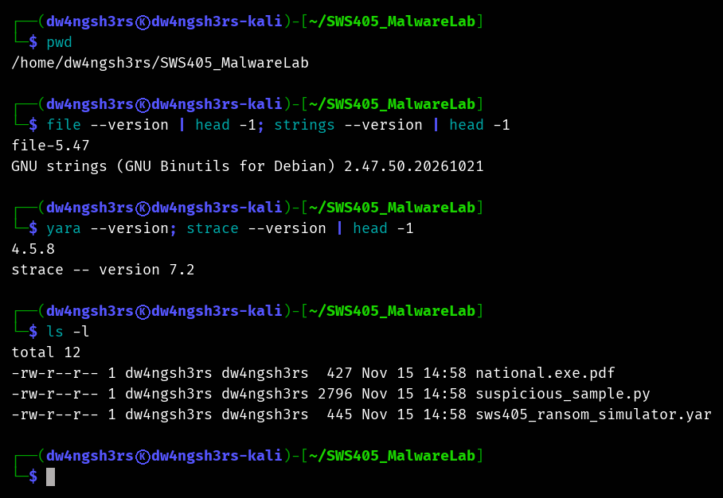
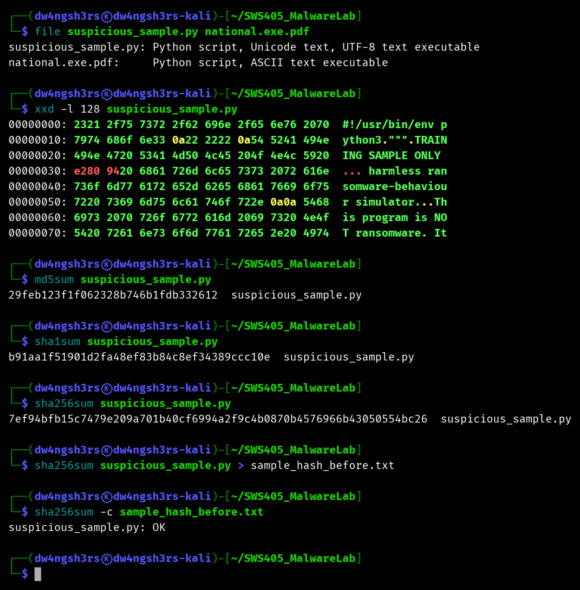
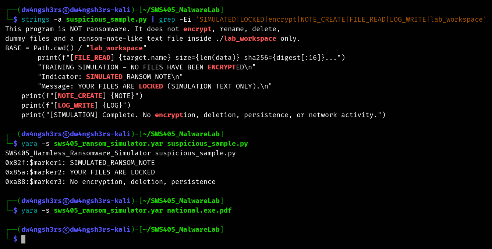
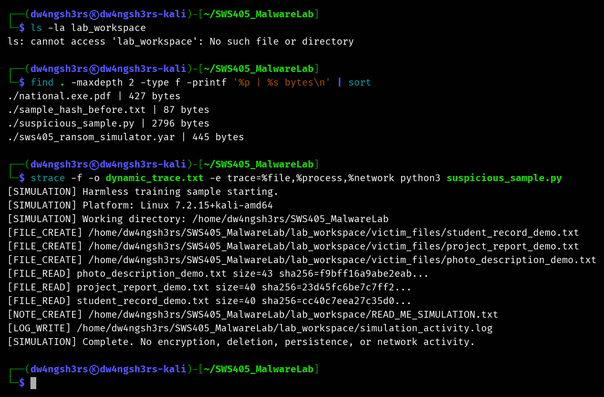
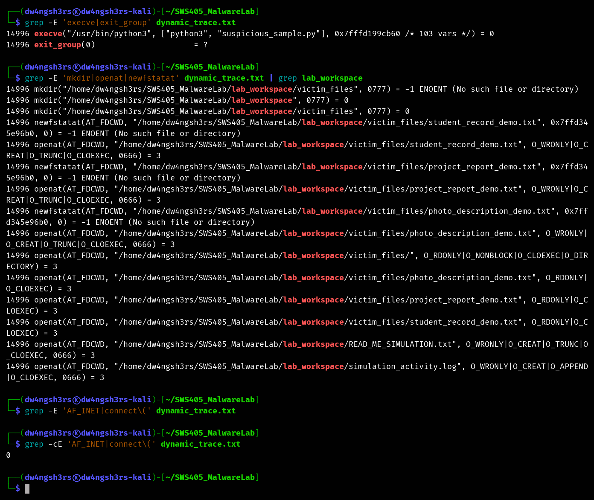
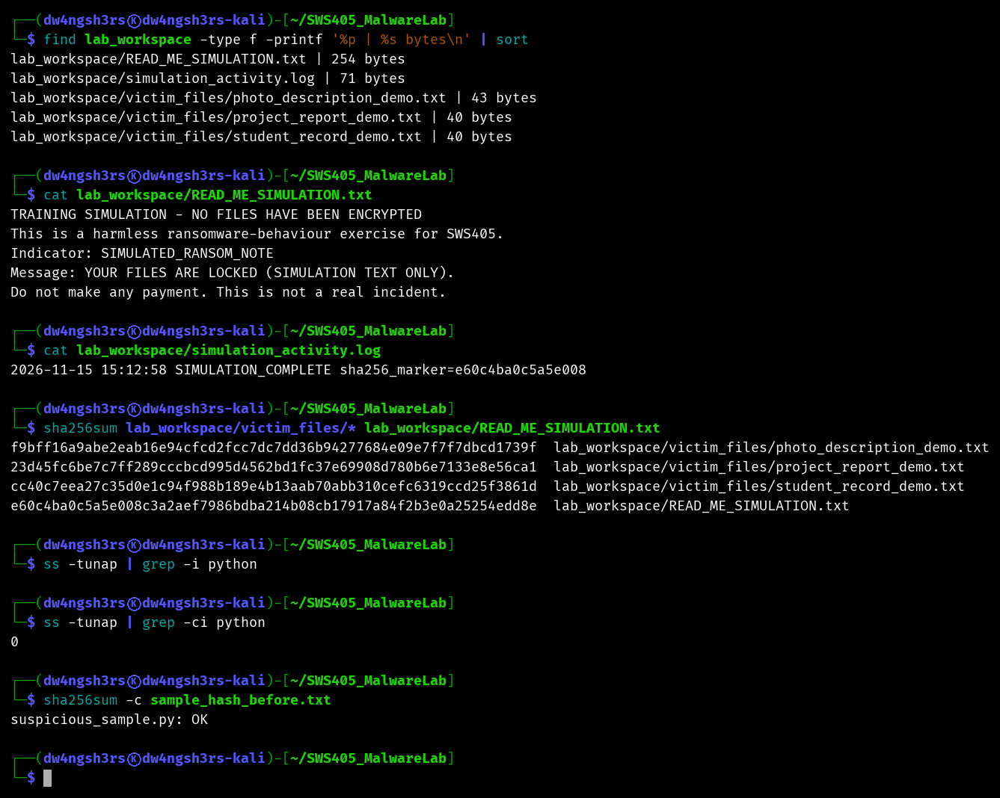

# Lab 06 — Static and Dynamic Malware Analysis on Kali Linux

**Course:** SWS405 — Digital Forensics

**Sample:** `suspicious_sample.py`, a harmless ransomware-behaviour simulator supplied by the tutor

---

## 1. Objective

Analyse a suspicious training sample in two stages:

1. **Static analysis** (the sample is not run): identify the real file type, fingerprint the sample with
   hashes, pull out readable strings, look at the raw bytes, and classify it with a YARA rule.
2. **Dynamic analysis** (controlled run): take a baseline, run the sample under `strace`, record which
   system calls and files it touches, check for network activity, and prove the sample did not change.

Then compare what static analysis predicted with what dynamic analysis showed, and record the results as
training IOCs.

> **Safety note.** This lab does **not** use real ransomware. Before running the sample, I read the full
> source of `suspicious_sample.py`. It only creates three dummy files, a ransom-note-style text file and a
> log, all inside `./lab_workspace`. It does not encrypt, rename, delete, persist or use the network.

---

## 2. Environment

| Item | Value |
|------|-------|
| OS | Kali Linux (kernel `7.2.15+kali-amd64`) |
| Working directory | `/home/dw4ngsh3rs/SWS405_MalwareLab` |
| `file` | 5.47 |
| `strings` | GNU Binutils 2.47.50 |
| `yara` | 4.5.8 | 
| `strace` | 7.2 |
| Python | 3.14 |
| Date of analysis | 2026-11-15 |

**Lab files (from the tutor's ZIP):**

| File | Purpose |
|------|---------|
| `suspicious_sample.py` | The training sample analysed in this lab |
| `sws405_ransom_simulator.yar` | YARA detection rule (matches if 2 of 3 markers are present) |
| `national.exe.pdf` | Extra file-identification exercise: a file with a misleading extension |
| `Part 01-Unit VII.pdf` | Lecture slides for Unit VII |
| `__MACOSX/` | macOS AppleDouble metadata (`com.apple.quarantine`) added when the ZIP was made on a Mac. It is not lab content and was ignored. |

---

## 3. Setup and tool verification

A dedicated working directory was created and only the sample, the YARA rule and the extension-trap
file were copied into it. `yara` and `strace` were installed with
`sudo apt install -y yara strace`. Each tool was then checked by printing its version.

```bash
mkdir -p ~/SWS405_MalwareLab && cd ~/SWS405_MalwareLab
pwd
file --version | head -1; strings --version | head -1
yara --version; strace --version | head -1
ls -l
```



**Result:** the working directory is `/home/dw4ngsh3rs/SWS405_MalwareLab`. All four analysis tools
print a version, and the directory holds only the three lab files. ✅

---

## 4. Part A — Static analysis (sample NOT executed)

### A1, A2, A4: File identification, header inspection and hashing

```bash
file suspicious_sample.py national.exe.pdf
xxd -l 128 suspicious_sample.py
md5sum suspicious_sample.py
sha1sum suspicious_sample.py
sha256sum suspicious_sample.py
sha256sum suspicious_sample.py > sample_hash_before.txt
sha256sum -c sample_hash_before.txt
```



**Findings:**

- `file` reports **`Python script, Unicode text, UTF-8 text executable`**. The sample is a text script,
  not a Windows PE executable.
- `national.exe.pdf` is also a **`Python script, ASCII text executable`**, even though its name suggests
  a PDF and an EXE. This shows that a filename extension tells you nothing reliable about a file's real
  type. `file` checks the content (magic bytes and format clues) instead.
- `xxd` shows that the first bytes are `23 21` = `#!` (the shebang `#!/usr/bin/env python3`). A Windows
  PE file would start with `4D 5A` (`MZ`), so this sample has **no PE header**. The red bytes
  `e2 80 94` at offset `0x30` are the UTF-8 em-dash (`—`), which explains why `file` reports *Unicode
  text*.
- Hashes recorded **before** analysis:

| Algorithm | Digest |
|-----------|--------|
| MD5 | `29feb123f1f062328b746b1fdb332612` |
| SHA-1 | `b91aa1f51901d2fa48ef83b84c8ef34389ccc10e` |
| **SHA-256** | **`7ef94bfb15c7479e209a701b40cf6994a2f9c4b0870b4576966b43050554bc26`** |

The SHA-256 was saved to `sample_hash_before.txt`, and `sha256sum -c` returned
**`suspicious_sample.py: OK`**. ✅

### A3, A5: Strings analysis and YARA pattern matching

```bash
strings -a suspicious_sample.py | grep -Ei 'SIMULATED|LOCKED|encrypt|NOTE_CREATE|FILE_READ|LOG_WRITE|lab_workspace'
yara -s sws405_ransom_simulator.yar suspicious_sample.py
yara -s sws405_ransom_simulator.yar national.exe.pdf
```



**Suspicious strings found and what they suggest:**

| String | Significance |
|--------|--------------|
| `SIMULATED_RANSOM_NOTE` | An indicator label linked to a ransom note |
| `YOUR FILES ARE LOCKED` | Typical ransom-note wording |
| `NO FILES HAVE BEEN ENCRYPTED` / `encrypt` | Mentions encryption, the core ransomware action |
| `lab_workspace` | Hard-coded target directory, so the sample probably writes files there |
| `FILE_READ`, `NOTE_CREATE`, `LOG_WRITE` | Log labels that suggest it reads files, drops a note and writes a log |

These strings suggest a **hypothesis**: the program creates and reads files, drops a ransom-note-like
file and writes a log inside `lab_workspace`. Strings alone cannot prove this, so Part B tests it.

**YARA:** the rule **`SWS405_Harmless_Ransomware_Simulator` matched**, and all **3 of 3** markers were
found:

| Identifier | Offset | Matched string |
|------------|--------|----------------|
| `$marker1` | `0x82f` | `SIMULATED_RANSOM_NOTE` |
| `$marker2` | `0x85a` | `YOUR FILES ARE LOCKED` |
| `$marker3` | `0xa88` | `No encryption, deletion, persistence` |

As a negative control, the same rule run against `national.exe.pdf` printed **nothing (no match)**. The
rule only fires on files that contain its marker strings. ✅

### A6. Static analysis worksheet

| Question | Student observation | What it means |
|----------|---------------------|---------------|
| What is the real file type? | Python script, UTF-8 text executable (starts with `#!`, no `MZ`) | Interpreted text script, not a PE binary. Do not trust the extension. |
| What is the SHA-256 hash? | `7ef94bfb15c7479e209a701b40cf6994a2f9c4b0870b4576966b43050554bc26` | Unique fingerprint of this exact content, used to identify it and check integrity |
| Which suspicious strings were found? | `SIMULATED_RANSOM_NOTE`, `YOUR FILES ARE LOCKED`, `encrypt`, `lab_workspace`, `FILE_READ`, `NOTE_CREATE`, `LOG_WRITE` | Ransomware-like wording and file-activity labels |
| What file operations are suggested? | Create a directory, create and read files, write a note, append to a log | These are the behaviours to confirm dynamically |
| Does YARA match? Which strings matched? | Yes: `SWS405_Harmless_Ransomware_Simulator`, `$marker1`, `$marker2` and `$marker3` | Known training pattern found (classification, not proof of malice) |
| What behaviour should be monitored dynamically? | Process start (`execve`), `mkdir`/`openat` under `lab_workspace`, any `socket`/`connect` | Confirm or reject each static prediction |

---

## 5. Part B — Dynamic analysis (controlled execution)

### B1, B3: Baseline, then execution under `strace`

```bash
ls -la lab_workspace                                   # baseline: should not exist yet
find . -maxdepth 2 -type f -printf '%p | %s bytes\n' | sort
strace -f -o dynamic_trace.txt -e trace=%file,%process,%network python3 suspicious_sample.py
```



**Baseline:** `lab_workspace` **did not exist** (`No such file or directory`). The directory held only
the four expected files: the sample, the rule, the trap file and `sample_hash_before.txt`.

**Execution:** the sample ran under `strace`, which followed child processes (`-f`) and recorded file,
process and network system calls to `dynamic_trace.txt` (307 lines). The program printed
`[FILE_CREATE]` ×3, `[FILE_READ]` ×3, `[NOTE_CREATE]` and `[LOG_WRITE]`, then finished with
`Complete. No encryption, deletion, persistence, or network activity.` ✅

> **B2 (process monitoring):** the sample ran for less than a second, so a `watch -n 1 ps …` monitor
> would probably miss it (the guide notes this is normal). Process activity is shown more reliably by
> the `execve`/`exit_group` records in the `strace` log below.

### B3 (continued), B5: System-call evidence and network check

```bash
grep -E 'execve|exit_group' dynamic_trace.txt
grep -E 'mkdir|openat|newfstatat' dynamic_trace.txt | grep lab_workspace
grep -E 'AF_INET|connect\(' dynamic_trace.txt
grep -cE 'AF_INET|connect\(' dynamic_trace.txt
```



**Process evidence:** a single process (PID 14996) started with
`execve("/usr/bin/python3", ["python3", "suspicious_sample.py"]) = 0` and exited with
`exit_group(0)`. No other processes were started.

**File-system evidence:**

| System call | What it shows |
|-------------|---------------|
| `mkdir(".../lab_workspace/victim_files") = -1 ENOENT` → `mkdir(".../lab_workspace") = 0` → `mkdir(".../victim_files") = 0` | `mkdir(parents=True)`: the parent directory is created first, then the child |
| `newfstatat(... student_record_demo.txt) = -1 ENOENT` | The sample checks whether each file exists before creating it |
| `openat(... *_demo.txt, O_WRONLY\|O_CREAT\|O_TRUNC)` ×3 | **Creates** the three dummy files |
| `openat(... victim_files/, O_RDONLY\|O_DIRECTORY)` | Lists the directory (the `glob("*.txt")` call) |
| `openat(... *_demo.txt, O_RDONLY)` ×3 | **Reads** each dummy file |
| `openat(... READ_ME_SIMULATION.txt, O_WRONLY\|O_CREAT\|O_TRUNC)` | Drops the ransom-note-style file |
| `openat(... simulation_activity.log, O_WRONLY\|O_CREAT\|O_APPEND)` | Appends to the activity log |

Every write lands **inside `lab_workspace`**. The trace has no `unlink` or `rename` calls, so nothing
was deleted or renamed.

**Network evidence:** `grep -E 'AF_INET|connect\('` returned **no lines**, and the count is **0**. A
broader search for `socket(`, `connect(`, `bind(` and `sendto` in the trace also returned 0. Because
`strace` was tracing `%network` calls, any socket activity would have been logged. ✅

### B4, B5, B6: Created files, ransom note, sockets and sample integrity

```bash
find lab_workspace -type f -printf '%p | %s bytes\n' | sort
cat lab_workspace/READ_ME_SIMULATION.txt
cat lab_workspace/simulation_activity.log
sha256sum lab_workspace/victim_files/* lab_workspace/READ_ME_SIMULATION.txt
ss -tunap | grep -i python
ss -tunap | grep -ci python
sha256sum -c sample_hash_before.txt
```



**Before and after comparison:** the baseline had **no** `lab_workspace`. After the run, these 5 new files
exist:

| New file | Size |
|----------|------|
| `lab_workspace/READ_ME_SIMULATION.txt` | 254 bytes |
| `lab_workspace/simulation_activity.log` | 71 bytes |
| `lab_workspace/victim_files/photo_description_demo.txt` | 43 bytes |
| `lab_workspace/victim_files/project_report_demo.txt` | 40 bytes |
| `lab_workspace/victim_files/student_record_demo.txt` | 40 bytes |

**Copy of the simulation note** (`READ_ME_SIMULATION.txt`):

```text
TRAINING SIMULATION - NO FILES HAVE BEEN ENCRYPTED
This is a harmless ransomware-behaviour exercise for SWS405.
Indicator: SIMULATED_RANSOM_NOTE
Message: YOUR FILES ARE LOCKED (SIMULATION TEXT ONLY).
Do not make any payment. This is not a real incident.
```

**Activity log:** `2026-11-15 15:12:58 SIMULATION_COMPLETE sha256_marker=e60c4ba0c5a5e008`. The marker
equals the first 16 hex characters of the note's SHA-256 (`e60c4ba0c5a5e008…`), which ties the log entry
to this note.

**Output file hashes:**

| File | SHA-256 |
|------|---------|
| `photo_description_demo.txt` | `f9bff16a9abe2eab16e94cfcd2fcc7dc7dd36b94277684e09e7f7f7dbcd1739f` |
| `project_report_demo.txt` | `23d45fc6be7c7ff289cccbcd995d4562bd1fc37e69908d780b6e7133e8e56ca1` |
| `student_record_demo.txt` | `cc40c7eea27c35d0e1c94f988b189e4b13aab70abb310cefc6319ccd25f3861d` |
| `READ_ME_SIMULATION.txt` | `e60c4ba0c5a5e008c3a2aef7986bdba214b08cb17917a84f2b3e0a25254edd8e` |

These match the `sha256=` prefixes the sample printed during `[FILE_READ]`, and the dummy files still
hold plain text (`DEMO DATA ONLY - ...`). **They were not encrypted.**

**Sockets:** `ss -tunap` shows **0** sockets owned by any `python` process. (The full listing showed only
unrelated system and application sockets, which were left out of the screenshot.)

**Integrity:** `sha256sum -c sample_hash_before.txt` → **`suspicious_sample.py: OK`**. The sample was not
modified during the analysis. ✅

---

## 6. Static versus dynamic findings

| Static observation / prediction | Dynamic evidence | Conclusion |
|---------------------------------|------------------|------------|
| Strings include `FILE_CREATE` and `lab_workspace` | `mkdir(".../lab_workspace") = 0` and 3× `openat(... O_CREAT)` | **Prediction confirmed** |
| Strings include `YOUR FILES ARE LOCKED` | `READ_ME_SIMULATION.txt` contains this training text | **Ransom-note wording is simulated** |
| Code contains file-reading logic (`FILE_READ`) | 3× `openat(... O_RDONLY)` on the dummy files | **File access observed** |
| No network indicators expected | 0 `AF_INET`/`connect`/`socket` calls in the trace, and 0 python sockets in `ss` | **No network activity observed in this run** |
| No encryption routine implemented | Dummy files still plain text, hashes match the values printed at read time, no `rename`/`unlink` | **No encryption observed** |
| File type is a Python script, not a PE | `execve("/usr/bin/python3", ...)`: run by the interpreter | **Confirmed** |

---

## 7. Indicators of compromise (training indicators only)

> These are **training indicators** for the SWS405 simulator. They are **not** evidence of a real
> ransomware infection.

| Type | Indicator |
|------|-----------|
| Sample filename | `suspicious_sample.py` |
| File type | Python script, UTF-8 text executable |
| MD5 | `29feb123f1f062328b746b1fdb332612` |
| SHA-1 | `b91aa1f51901d2fa48ef83b84c8ef34389ccc10e` |
| SHA-256 | `7ef94bfb15c7479e209a701b40cf6994a2f9c4b0870b4576966b43050554bc26` |
| YARA rule match | `SWS405_Harmless_Ransomware_Simulator` (`$marker1`, `$marker2`, `$marker3`) |
| Process | `python3 suspicious_sample.py` (single process, exit code 0) |
| Created directory | `./lab_workspace/victim_files/` |
| Created note | `./lab_workspace/READ_ME_SIMULATION.txt` (SHA-256 `e60c4ba0…54edd8e`) |
| Created log | `./lab_workspace/simulation_activity.log` |
| Note marker string | `SIMULATED_RANSOM_NOTE` |
| Network activity | None observed during this run |

---

## 8. Answers to the practical questions

1. **Why use `file` instead of trusting the extension?** Anyone can change an extension, and attackers
   do this on purpose to trick users (for example `invoice.pdf.exe`). `file` reads the content's magic
   bytes and structure. In this lab, `national.exe.pdf` looked like both a PDF and an EXE, but `file`
   showed it is a **Python script**.
2. **Difference between a filename and a cryptographic hash?** A filename is a label that can be changed
   without touching the content. A hash such as SHA-256 is computed from every byte of the content.
   Changing a single byte produces a completely different hash, so the hash identifies the exact
   content and is used to check integrity.
3. **Which strings suggested suspicious behaviour?** `SIMULATED_RANSOM_NOTE`, `YOUR FILES ARE LOCKED`,
   `NO FILES HAVE BEEN ENCRYPTED`/`encrypt`, `lab_workspace`, `FILE_READ`, `NOTE_CREATE` and `LOG_WRITE`.
4. **Why doesn't a YARA match prove a file is malicious?** YARA only finds patterns. Benign files can
   contain the same strings: this report, an antivirus signature file or a security article could all
   match (false positives). Real malware can also be changed to avoid the strings (false negatives).
   Even the matching marker `$marker3` here is the sample saying it is harmless.
5. **Which `strace` system calls show file creation or access?** `mkdir(...lab_workspace) = 0`,
   `openat(... O_WRONLY|O_CREAT|O_TRUNC)` for the dummy files and the note,
   `openat(... O_WRONLY|O_CREAT|O_APPEND)` for the log, `openat(... O_RDONLY)` for reading the dummy
   files, and `newfstatat(...) = -1 ENOENT` for the existence checks.
6. **What changed between the baseline and post-execution listings?** A new `lab_workspace/` directory
   appeared, containing `victim_files/` with 3 dummy `.txt` files, `READ_ME_SIMULATION.txt` and
   `simulation_activity.log` (5 new files). No existing file changed, and the sample hash still
   verifies as OK.
7. **Did the sample communicate over the network?** No. `strace` was tracing `%network` calls and recorded
   0 `socket`/`connect`/`AF_INET` calls. `ss -tunap` showed no sockets owned by `python`. This applies to
   this run only.
8. **One static prediction confirmed by dynamic analysis:** the `lab_workspace` and `FILE_CREATE` strings
   predicted file creation in that folder. `strace` confirmed it with `mkdir(".../lab_workspace") = 0` and
   three `openat(... O_CREAT)` calls.
9. **Why revert the VM afterwards?** Running a sample can leave changes (files, persistence, altered
   settings) that you might not have noticed. Reverting to a clean snapshot removes all of them, stops
   evidence from one exercise contaminating the next, and returns the analysis environment to a known
   good state.

---

## 9. Conclusion

Static analysis showed that `suspicious_sample.py` is a Python text script (SHA-256 `7ef94bfb…0554bc26`),
not a PE executable, and that it contains ransomware-style strings and file-activity markers. The
SWS405 YARA rule matched it on all three markers and did not match the control file. Dynamic analysis
under `strace` confirmed every static prediction: one `python3` process created `lab_workspace/` with
three dummy files, read them, dropped a simulated ransom note and appended to a log. It made **no**
network calls and performed **no** encryption, deletion or renaming. The sample's hash was unchanged
after the analysis. The sample is a **harmless ransomware-behaviour simulator**, and the lab shows how
static analysis builds a hypothesis that dynamic analysis then confirms with evidence.

---

